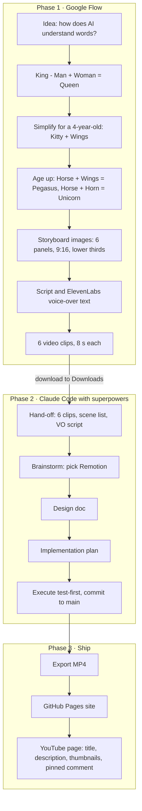

# 🐴➡️🦄 Google Flow Vectors

> **Live page:** 🌐 https://rifaterdemsahin.github.io/google-flow-vectors/
>
> **YouTube upload page** (title, description, 3 thumbnails): 📺 https://rifaterdemsahin.github.io/google-flow-vectors/youtube.html

A 48-second vertical **YouTube Short** that explains how AI understands words — using a horse. 🧠✨

## 💡 The idea
AI doesn't read letters. It turns every concept into a **vector** (a direction arrow on a giant map), so meaning becomes math:

- 🐴 **Horse** = the base vector
- 🐴 + 🪽 **Wings** = **Pegasus**
- 🐴 + 🦄 **Horn** = **Unicorn**
- 🪽 **Pegasus − Wings + Horn = Unicorn** ➗
- 🥚 **Token 9246** hides inside the final scene as an Easter egg, and the last line flows back into the first so the Short **loops** 🔁

## 🎬 What this repo does
| Step | What | Tool |
|---|---|---|
| 1️⃣ Input | Six 8-second AI-generated clips (made in **Google Flow**) | `assets/clips/` |
| 2️⃣ Voice-over | One ElevenLabs voice line per scene | **fal.ai** → `assets/vo/` |
| 3️⃣ Timing | Word-level timestamps from Whisper, mapped onto the script | **fal.ai Whisper** → `assets/captions.json` |
| 4️⃣ Compose | Clips + voice + animated word-by-word captions + loop crossfade | **Remotion** (React) |
| 5️⃣ Export | `out/short_1080x1920.mp4` (1080×1920, 24fps, H.264/AAC, < 25 MB) | `npm run build:video` |

## 🗺️ Workflow: Google Flow → Claude Code
Started in **Google Flow** (idea, storyboard, clips, voice-over script), then moved to **Claude Code** to build, verify and ship it. Full write-up with more diagrams: [`docs/workflow.md`](docs/workflow.md).



## 🚀 Run it
```bash
npm install
cp .env.example .env        # add your FAL_KEY 🔑 (never committed)
npm run build:video         # ingest → voice-over → timings → render
node scripts/verify-export.mjs   # ✅ checks format, duration, size, audio
npm run studio              # 🎛️ open Remotion Studio to preview/edit
```

## 🗂️ Layout
- `src/` — Remotion composition, caption logic (`captions/chunk.ts`, `captions/align.ts`), scene script
- `scripts/` — `ingest-clips`, `tts` (fal ElevenLabs), `align` (fal Whisper), `verify-export`
- `tests/` — vitest suite (`npm test`)
- `docs/superpowers/` — 📝 design spec and implementation plan

## 🧪 How it was built
Trunk-based on `main`, test-first (TDD), planned with the *superpowers* skills: brainstorm → design → plan → execute. Captions use the **script's own words** (Whisper only supplies timing), so names like "Pegasus" and "9246" are always spelled right. Clips already carry their own lower-third cards, so captions sit in a **lower band just above them**, and a **Skool CTA** closes the video. 🎯
