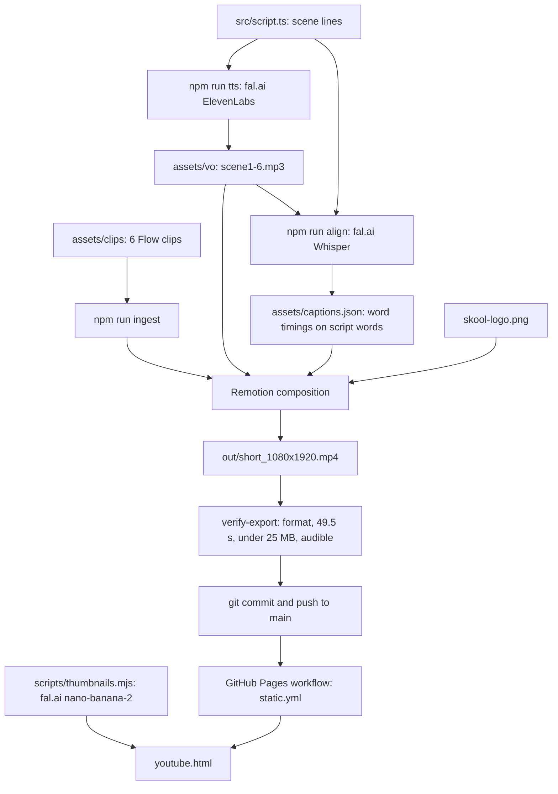
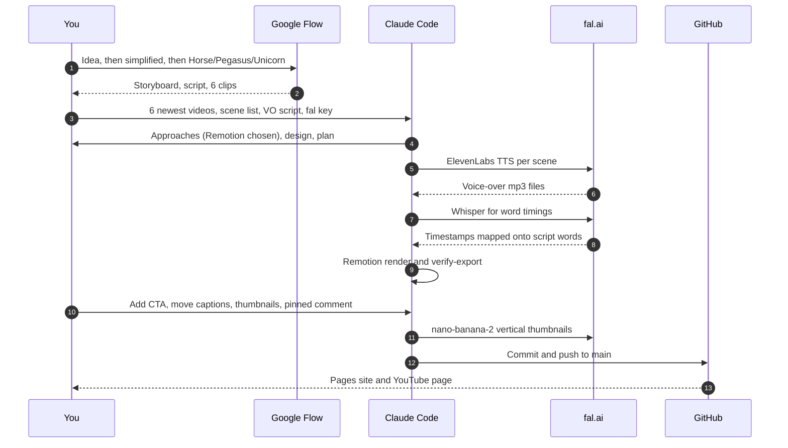
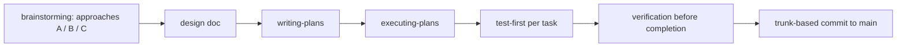

# 🗺️ How this Short was created: Google Flow → Claude Code → YouTube

The video was started in **Google Flow** (idea, storyboard, clips, voice-over script) and finished in **Claude Code** (voice-over, captions, composition, export, publishing). Everything after the hand-off is code in this repo.

## 1. The whole journey

```mermaid
flowchart LR
  subgraph FLOW["Phase 1 · Google Flow"]
    direction TB
    A["Idea: how does AI understand words?"] --> B["King - Man + Woman = Queen"]
    B --> C["Simplify for a 4-year-old: Kitty + Wings"]
    C --> D["Age up: Horse + Wings = Pegasus, Horse + Horn = Unicorn"]
    D --> E["Storyboard images: 6 panels, 9:16, lower thirds"]
    E --> F["Script and ElevenLabs voice-over text"]
    F --> G["6 video clips, 8 s each"]
  end
  subgraph CLAUDE["Phase 2 · Claude Code with superpowers"]
    direction TB
    H["Hand-off: 6 clips, scene list, VO script"] --> I["Brainstorm: pick Remotion"]
    I --> J["Design doc"]
    J --> K["Implementation plan"]
    K --> L["Execute test-first, commit to main"]
  end
  subgraph SHIP["Phase 3 · Ship"]
    direction TB
    M["Export MP4"] --> N["GitHub Pages site"]
    N --> O["YouTube page: title, description, thumbnails, pinned comment"]
  end
  G -->|"download to Downloads"| H
  L --> M
```

## 2. What the code does (build pipeline)

## 3. Who did what

## 4. The superpowers process used in Claude

## Notes
- The clips already had lower-third cards burned in, so captions sit just above them instead of adding more.
- The `.github/workflows/static.yml` workflow publishes the repo root to GitHub Pages on every push to `main`.
- Secrets live only in the gitignored `.env`.
